# Skin Lesion Classification — HAM10000

This is the Applied Machine Learning project repository classifying dermatoscopic images into the **7 lesion
types** of the *Skin Cancer MNIST: HAM10000* dataset. It covers data
exploration, class-imbalance handling, model training/validation/testing,
and interpretability.

This README has two parts: **Part 1** is what you need to reproduce the
project end to end. **Part 2** is a step-by-step walkthrough of the project that
reports and discusses observations, results and limitations.

---

## Use of generative AI in this project

AI was used for code debugging, language polishing, and
refactoring; all methodological choices, experiments, and interpretations
were reviewed and validated by me.

- **Conceptualization.** The project was structured based on my ideas.
  AI helped in structuring folders and workflows to be simple and clear to read.
- **Code generation.** I used AI to write some parts of the code to train
  and validate the models, under my direction and review.
- **Evaluation.** All results are from actually executed runs; AI helped read and cross-check the outputs, but result
  interpretation was reviewed and validated by me.

---

# Part 1 — Reproducing the project

## The task

10,015 dermatoscopy images, 7 classes, **severely imbalanced**:

| code | diagnosis | approx. share |
|------|-----------|---------------|
| `nv`    | Melanocytic nevi          | ~67% (dominant) |
| `mel`   | Melanoma (malignant)      | ~11% |
| `bkl`   | Benign keratosis          | ~11% |
| `bcc`   | Basal cell carcinoma      | ~5% |
| `akiec` | Actinic keratoses         | ~3% |
| `vasc`  | Vascular lesions          | ~1% |
| `df`    | Dermatofibroma            | ~1% (rarest) |


## Repository layout

```
AML-HAM10000/
├── config.yaml            # central config overridable on the CLI
├── prepare_data.py        # extract data + split
├── train.py               # train one model
├── src/
│   ├── dataset.py         # Dataset + class-weight / oversampling utilities
│   ├── transforms.py      # Augmentation pipeline
│   ├── models.py          # SimpleCNN + ResNet18 factory
│   ├── engine.py          # train/val loop, CSV logging, early stopping
│   ├── evaluate.py        # test-set metrics
│   ├── baselines.py       # dummy + classical baselines
│   └── interpret.py       # interpretability helpers
├── notebooks/
│   ├── 01_data_exploration.ipynb
│   ├── 02_results_analysis.ipynb
│   └── 03_interpretability.ipynb
├── logs/                  # per-epoch metrics CSV
├── models/                # checkpoints
├── figures/               # exported plots
└── data/                  # dataset
```

## Setup

The project uses a Python 3.12 virtualenv at `.venv/` in the repo root.

To recreate the environment elsewhere:

```bash
python3.12 -m venv .venv
source .venv/bin/activate
pip install -r requirements.txt jupyter ipykernel
```

## 1. Get the data

Download **Skin Cancer MNIST: HAM10000** from Kaggle
(<https://www.kaggle.com/datasets/kmader/skin-cancer-mnist-ham10000>) and place
the zip in `data/raw/`. Then:

```bash
python prepare_data.py
```

This extracts the archive, merges the two image folders into `data/raw/images/`,
and writes `data/processed/metadata_splits.csv` with a **leakage-safe** `split`
column, grouped by `lesion_id`.

## 2. Explore

```bash
jupyter lab notebooks/01_data_exploration.ipynb
```

Fully discussed in Part 2.

## 3. Train the experiment matrix

You can run each train separately, in order to selectively choose which model
and imbalance strategy to include in the evaluation:

```bash
python train.py --model simple_cnn --imbalance none           --run-name cnn_none
python train.py --model simple_cnn --imbalance weighted_loss  --run-name cnn_weighted
python train.py --model simple_cnn --imbalance oversampling   --run-name cnn_oversample
python train.py --model resnet18   --imbalance none           --run-name resnet_none
python train.py --model resnet18   --imbalance weighted_loss  --run-name resnet_weighted
python train.py --model resnet18   --imbalance oversampling   --run-name resnet_oversample
```

**Imbalance strategies**

- `none` — plain cross-entropy on the natural distribution (baseline).
- `weighted_loss` — cross-entropy weighted by inverse class frequency.
- `oversampling` — `WeightedRandomSampler` draws rare classes more often, so classes are balanced on average.

Each run logs per-epoch metrics to `logs/<run>.csv` and saves the best
checkpoint (by **validation macro-F1**) to `models/<run>.pt`.

## 4. Analyse results

```bash
jupyter lab notebooks/02_results_analysis.ipynb
```

Non-ML/classical baselines, training curves, the test-set comparison table,
per-class recall, the clinical model-selection criterion, and the confusion
matrix of the model actually carried forward. Discussed in
full in Part 2.

## 5. Interpretability

```bash
jupyter lab notebooks/03_interpretability.ipynb
```

Interpretability techniques applied, plus a failure
analysis of the melanomas it calls benign, to check whether the model looks
at the **lesion** or at other artefacts (hair, dermatoscope
vignette). Discussed in full in Part 2.

---

# Part 2 — Walking through the project

## Notebook 1 — Data exploration

### 1. Class distribution

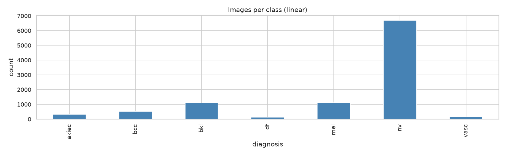

Raw counts: `nv` 6705, `mel` 1113, `bkl` 1099, `bcc` 514, `akiec` 327, `vasc`
142, `df` 115. `nv` alone is 67% of the dataset; the four smallest classes
combined (`bcc`, `akiec`, `vasc`, `df`) are under 11%. A classifier that
always predicts `nv` scores ~67% accuracy while catching zero of anything
else. This is why accuracy is dropped in favour of balanced accuracy and
macro-F1 everywhere downstream.

### 2. What the images look like

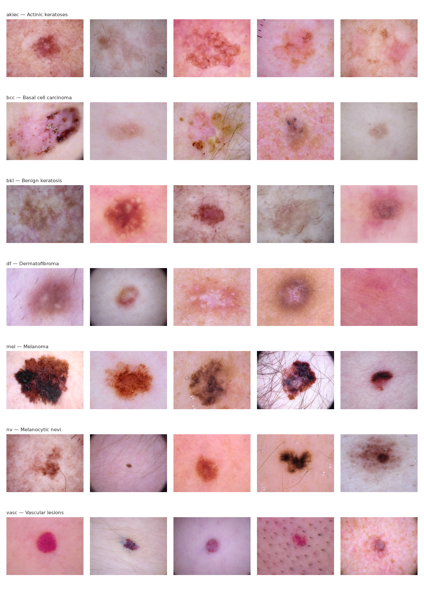

Five random examples per class. Two things worth noting beyond the obvious
per-class visual differences: image quality is inconsistent even within a
class (contrast, zoom level, in-focus vs. blurry), and several images carry
non-lesion artefacts: dense hair (`mel` row, image 4; `nv` row, image 4),
ruler tick marks (`akiec` row, image 4), and a dark circular dermatoscope
vignette around the frame edge (`mel` row, image 4).
These artefacts are not negligible, we have to understand if the trained model
has its focus on these in correspondence to some of its mistakes.

### 3. Patient metadata

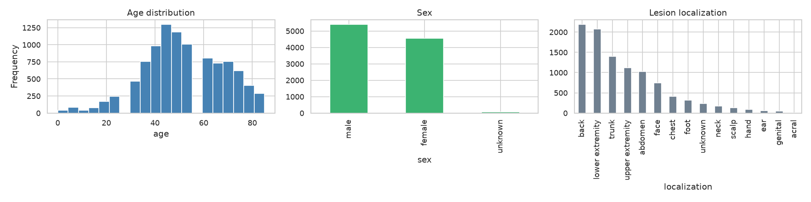

Age is roughly bell-shaped over 30–70 with a smaller cohort in the 60s–80s;
57 of 10,015 rows (0.6%) have missing age, sex is skewed toward male (~5.4k
vs ~4.5k female), and lesion location is
dominated by back, lower extremity, trunk, and upper extremity.

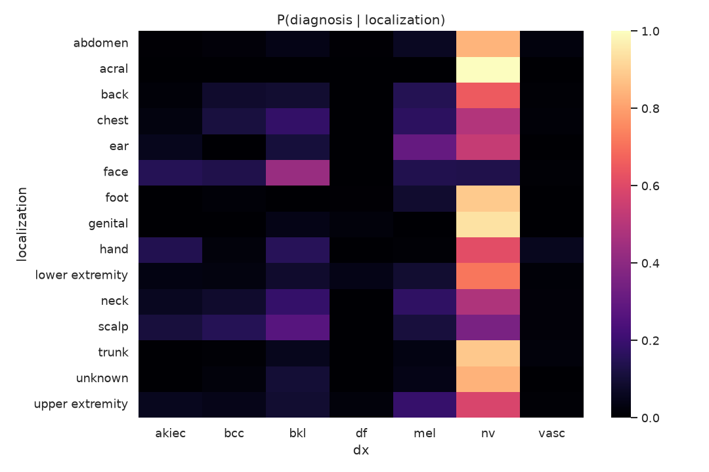

Row-normalized `P(diagnosis | localization)`. `nv` dominates almost every
site, unsurprising given its base rate, but two patterns stand out: `bkl`'s
share is visibly higher on `face` and `scalp` than elsewhere, and `akiec`
(actinic keratosis) is more represented on `face` and
`hand` than on trunk/back, consistent with sun-exposed skin.

The models are nevertheless trained on images only. This is a scope choice:
the focus of the project is class-imbalance handling and interpretability,
not the best achievable score, and an images-only model keeps every
explanation of the interpretability section attributable to pixels alone. Adding metadata
would likely improve performance, but is out of the scope of this specific project.

### 4. The split: grouping by `lesion_id`

10,015 images come from only **7,470 distinct lesions**, and 1,956 lesions were
photographed more than once. Two photos of
the same lesion can be considered near-duplicates for this task;
if one lands in train and its twin in
test, the test score is inflated because the model has "almost" seen the
test image already. `prepare_data.py` assigns each *lesion*, not each
*image*, to a single split, in order to have **zero lesions cross a
split boundary**, with similar class proportions across splits:

| split | akiec | bcc | bkl | df | mel | nv | vasc | images |
|-------|-------|-----|-----|-----|-----|-----|------|--------|
| train | 3.3% | 5.2% | 11.1% | 1.1% | 11.1% | 66.8% | 1.4% | 7002 |
| val   | 3.3% | 5.0% | 10.2% | 1.2% | 11.1% | 67.5% | 1.6% | 1532 |
| test  | 3.1% | 4.8% | 11.3% | 1.4% | 11.1% | 67.0% | 1.3% | 1481 |

### 5. Normalization statistics

Before an image is fed to a network, its pixel values are usually
normalized per colour channel: a mean is subtracted and the result is divided
by a standard deviation. When these are the data's own statistics, the inputs
end up centred on 0 with a spread of about 1, which is generally considered
to help optimization. Other schemes exist (scaling to [0, 1] or [-1, 1],
per-image normalization, or none at all with batch normalization doing the
work), so this is common practice, not a rule.

The statistics are computed on the **train split only**, so nothing from
the validation or test images influences preprocessing. Per channel (R, G, B):

| | mean | std |
|---|---|---|
| HAM10000 train split | 0.764, 0.544, 0.568 | 0.142, 0.155, 0.172 |
| ImageNet (standard values) | 0.485, 0.456, 0.406 | 0.229, 0.224, 0.225 |

The HAM10000 images are brighter, more red, and lower in contrast than
typical natural photos (higher mean, smaller std), which is what skin and
pink/red tissue would give.

Which statistics a model uses depends on where its weights come from:

- **`simple_cnn`** is trained from scratch, so it has no prior about its
  input distribution. It uses the HAM10000 statistics, which centre its
  actual inputs.
- **`resnet18`** starts from weights pretrained on ImageNet, whose filters
  learned on ImageNet-normalized images. It uses the ImageNet statistics so
  the preprocessing matches what those weights were trained with. Because
  HAM10000 differs from ImageNet, its inputs are not exactly centred: from
  the table above, the red channel comes out at a mean of about +1.2 and a
  std of about 0.6.


## Notebook 2 — Results analysis

### 0. Non-ML and classical baselines

Four models that involve no deep learning (`src/baselines.py`):

- `dummy_majority` always predicts `nv`.
- `dummy_stratified` guesses randomly, following the class frequencies of the
  training set.
- `classical_logreg` is a multinomial logistic regression on standardized
  features, with class weights balanced by inverse class frequency.
- `classical_rf` is a random forest (300 trees) on the same features, also
  with balanced class weights.

The two classical models cannot read an image directly, they need a
fixed-length vector per image. Each image is downscaled to 64×64 and described
by 16-bin histograms of each RGB channel and each HSV channel
(the colour distribution), plus the mean and standard deviation of each RGB
channel (overall tone and contrast). Colour was chosen because it is cheap to
compute and lesion types visibly differ in it (e.g. the red `vasc` lesions and
the dark brown/black melanomas in the sample grid). These features discard
spatial layout, so shape, border, and texture arrangement are invisible to
these models: the baseline measures how far colour alone gets without a CNN.
No other feature sets were tried.

| run | accuracy | balanced_accuracy | macro_f1 | macro_auc (one-vs-rest) |
|---|---|---|---|---|
| dummy_majority | 0.670 | 0.143 | 0.115 | 0.500 |
| dummy_stratified | 0.472 | 0.134 | 0.135 | 0.495 |
| classical_logreg | 0.525 | 0.461 | 0.341 | 0.830 |
| classical_rf | 0.654 | 0.429 | 0.408 | 0.879 |

`dummy_majority` shows the accuracy trap with an actual
number: 67% accuracy, 0.115 macro-F1. More interesting is `classical_rf`,
which has no CNN and no spatial structure yet reaches 0.408 macro-F1 and
0.879 macro-AUC.

### 1. Training curves

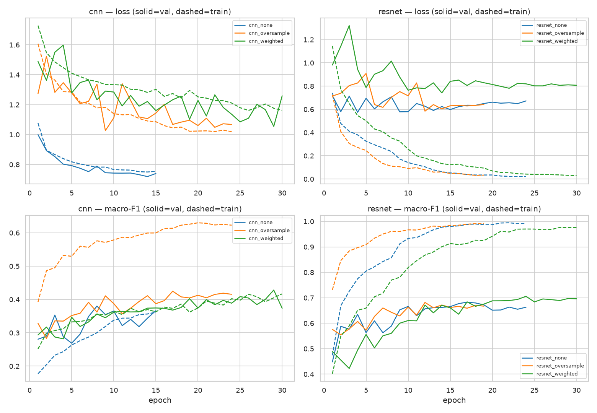

CNN and ResNet runs are split into their own columns (dashed = train, solid
= validation), since the two families sit on different scales. The
right column shows the `resnet` gap directly: validation macro-F1
converges by ~epoch 10–15 to a plateau around 0.65–0.70, while train
macro-F1 keeps climbing toward 0.95–1.0 and train loss keeps falling toward
0. This is a persistent train/validation gap that early stopping and
checkpoint selection contain but do not close. The left column shows a worse (and expected) results: `cnn` validation plateaus much lower (0.30–0.42), but
train and validation stay close together throughout. Probably these models are too
weak to overfit much, they're underfitting instead.

The `resnet` gap has been investigated (even if not shown in this notebook to avoid adding too many experiments and since this is not the primary focus of the project). Eight isolated changes have been tested: dropout before the head, increasing weight decay, focal
loss, two-stage fine-tuning (frozen backbone warmup then unfrozen at a
lower learning rate), and four alternative architectures (ResNet50,
DenseNet121, EfficientNet-B3, ConvNeXt-Tiny) spanning 7M–28M parameters.
All these tests left the gap in essentially the same 0.22–0.27 range as the untouched
baseline. Only freezing the backbone entirely, or a much stronger geometric
augmentation, closed it, and only by collapsing both train and validation
macro-F1 to ~0.40–0.55, which cannot be considered a better result.

### 2. Test-set comparison table

Validation results are used for resoning upon the "best" model to select: the test
results below are a final report of all runs.

| run | accuracy | balanced_accuracy | macro_f1 | weighted_f1 | macro_auc_ovr |
|---|---|---|---|---|---|
| resnet_none | 0.848 | 0.702 | **0.721** | 0.843 | 0.960 |
| resnet_weighted | 0.821 | 0.727 | 0.712 | 0.826 | 0.958 |
| resnet_oversample | 0.820 | 0.700 | 0.708 | 0.822 | 0.960 |
| classical_rf | 0.654 | 0.429 | 0.408 | 0.681 | 0.879 |
| cnn_weighted | 0.585 | 0.477 | 0.371 | 0.639 | 0.874 |
| cnn_oversample | 0.560 | 0.497 | 0.361 | 0.620 | 0.873 |
| classical_logreg | 0.525 | 0.461 | 0.341 | 0.589 | 0.830 |
| cnn_none | 0.710 | 0.344 | 0.340 | 0.702 | 0.870 |
| dummy_stratified | 0.472 | 0.134 | 0.135 | 0.472 | 0.495 |
| dummy_majority | 0.670 | 0.143 | 0.115 | 0.537 | 0.500 |

Two observations: first, on
macro-F1 the from-scratch CNN does not clearly beat the classical
color-histogram + random-forest baseline: `cnn_weighted` (0.371) and
`cnn_oversample` (0.361) are close to `classical_rf` (0.408), and
`cnn_none` (0.340) is below it. Deep learning only wins decisively once
transfer learning (`resnet18`) is introduced. Second, `cnn_none` shows the
accuracy trap again in a real trained model, not just the dummy baseline:
0.710 accuracy but 0.340 macro-F1 and 0.344 balanced accuracy. It is
scoring well by defaulting toward the majority class, not by learning the
rare ones.

### 3. Per-class recall: which lesions get caught?

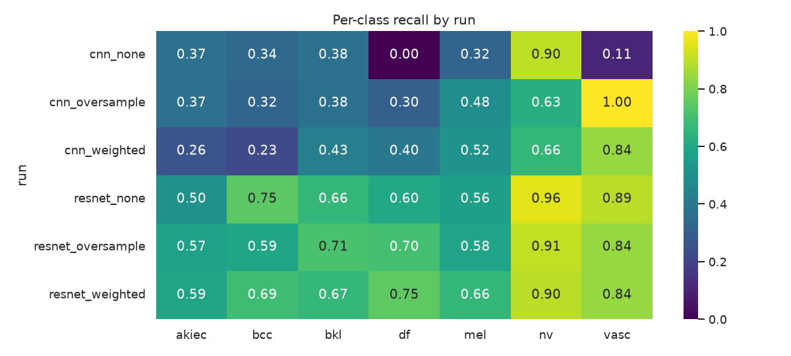

`nv` recall is high everywhere (0.63–0.96) simply because it is the majority
class, it says little about imbalance handling. The informative row is
`df`: recall goes from 0.00 under `cnn_none` (never predicted correctly,
unsurprising at ~1% of training data under plain cross-entropy) to
0.30–0.75 once weighting or oversampling is applied, reaching 0.75 under
`resnet_weighted`. That is direct evidence the imbalance strategies are
doing what they're meant to do, not just a training curve moving.

### Redefining "best model" based on the clinical task

The ranking above treats a wrong prediction as equally bad regardless of
which wrong class it lands on. Clinically it isn't: `mel`, `bcc`, and
`akiec` are malignant/premalignant lesions and need further analysis by specialists; `bkl`,
`df`, `nv`, `vasc` are benign. The costly failure is a malignant lesion
predicted as benign because the patient gets no follow-up. Being wrong *within* the malignant group (e.g. melanoma
called basal cell carcinoma) is still an error but a far safer one, since it
still routes the patient toward further analysis.
So the error we focus on for a screening task is P(predicted benign | true malignant). (Actually, this rate alone is incomplete: it can always be lowered by calling more lesions malignant, at the cost of more false alarms. We report only this side, so a lower value below should be read as a different trade-off, not necessarily a better model.)

The choice is made on the validation set:

| run | malignant_missed_as_benign | mel_missed_as_benign | bcc_missed_as_benign | akiec_missed_as_benign |
|---|---|---|---|---|
| resnet_weighted | **0.248** | 0.312 | 0.117 | 0.235 |
| cnn_oversample | 0.275 | 0.294 | 0.312 | 0.157 |
| resnet_none | 0.319 | 0.441 | 0.117 | 0.216 |
| resnet_oversample | 0.349 | 0.447 | 0.195 | 0.255 |
| cnn_weighted | 0.393 | 0.371 | 0.519 | 0.275 |
| cnn_none | 0.456 | 0.606 | 0.325 | 0.157 |

```
Best by macro-F1                   : resnet_weighted   macro_f1=0.706
Best by melanoma recall            : resnet_weighted   mel_recall=0.62
Best by malignant-missed-as-benign : resnet_weighted   rate=0.248
```

`resnet_weighted` is the selected model. On validation it is first on all
three criteria, so in our runs the clinical criterion and macro-F1 agree;
the argument above still motivates looking at the clinical rate, but our
experiments do not show the two disagreeing.

On the test set, `resnet_weighted`
misses 24.8% of malignant lesions (27.9% of melanomas), against 33.3% for
`resnet_none`.

### 4. Confusion matrix of the selected model

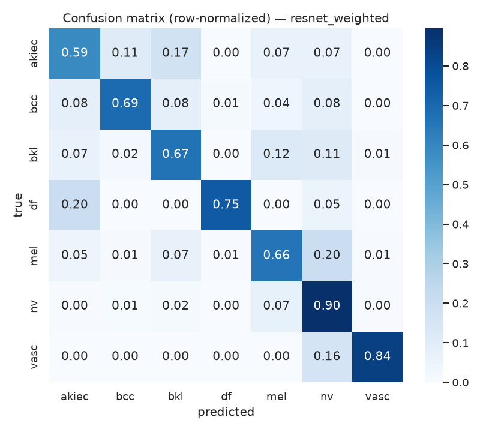

`nv` recall is 0.90, as expected for the
majority class. The clinically relevant row is `mel`: 0.66 diagonal, with
0.20 of true melanomas predicted `nv` and 0.07 predicted `bkl`. This 0.20
mass is exactly what motivates a failure analysis.
`akiec` sits at 0.59 with 0.17 confused as `bkl` and 0.11 as `bcc`, which can be considered visually similar if we take a look at some previous examples.
`df`→`akiec` at 0.20 is a benign lesion called premalignant, which is an
"over-caution" error, so lower danger than
the opposite would be.

## Notebook 3 — Interpretability

A model that reaches high accuracy might be relying on **artefacts** (e.g. hair, dermatoscope
vignette) rather than the lesion. We try to open the black box two ways:
**Grad-CAM** (where does the model look) and **LIME** (which superpixels
support the prediction). I also tried SHAP but its pixel-level attributions
were too noisy on these images to read reliably, so it's dropped here in
favour of the two methods that gave at least a "legible signal".

The model explained here is `resnet_weighted`, selected following the clinical criterion
established previously.

### 1. Grad-CAM: where is the model looking?

Grad-CAM shows which parts of an image a CNN relied on for a given prediction. The last convolutional layer of the network produces a set of coarse feature maps, each marking where in the image a certain visual pattern was detected. For a chosen class, Grad-CAM measures how much each of these maps contributes to that class's score: maps that push the score up get a large weight, maps that do not matter get a small one. The weighted maps are then combined, enlarged to the size of the input image and drawn as a colour overlay, where warm regions are the ones that most supported the class. The heatmap shows where the model looked, not what it saw there, so it can tell us whether attention was on the lesion or on hair and vignette, but not why the model decided as it did.

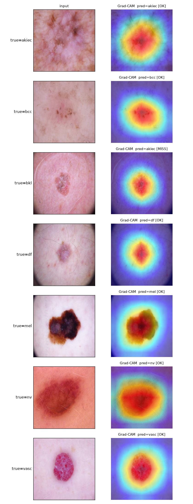

We look at one example per class, analyzing the heatmap over the model's own predicted class. For
6 of 7 classes the heat concentrates tightly on the lesion, not on
background or edges. The one miss in this batch (`bkl` example, predicted
`akiec`) still has heat centered on the lesion, indicating that the model looked at the
right region and reached the wrong conclusion, not a localization failure.
This is just a sanity check that cannot be used as a "proof" to drive conclusions, but still can be informative on the typology of error that drives mispredictions.

### 2. LIME: superpixel explanation

LIME explains one prediction by testing what happens when parts of the image are removed. The image is first cut into "superpixels", small regions of similar colour and texture. LIME then creates many altered copies of the image in which random superpixels are hidden, and records how the model's score for the class of interest changes on each copy. Finally it fits a very simple model that relates "which regions were visible" to "how high the score was": regions whose presence raises the score are the ones supporting the prediction. Unlike Grad-CAM, LIME only needs the model's outputs, not its internals. The explanation depends on how the image was segmented and comes from random sampling. The seed is fixed so the figures are reproducible, but the outlines still depend on it, so a single LIME picture is weak evidence on its own.
Again, it is important to stress that it only shows which regions the prediction is sensitive to, not that they are diagnostically meaningful.

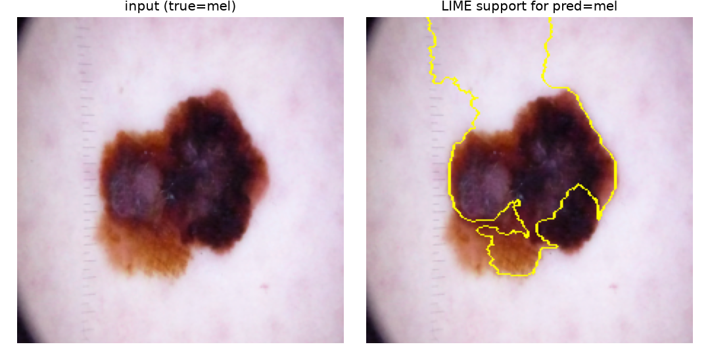

We see a LIME explanation for a melanoma sample in the test set, correctly predicted. The yellow outlines mark the superpixels that most supported the prediction. The outline covers most of the lesion and also a band of skin above it, so it is mostly, but not only, on the lesion, in line with the Grad-CAM map for the same image.

### 3. Failure analysis: melanomas the model called benign

The examples above are just the first test image of each class and say
little about the failures that matter for the clinical criterion. Of 165
melanomas in the test set, **46 (27.9%) are predicted as one of the benign
classes**, consistent with the test-set `mel_missed_as_benign` rate of 0.279 reported in notebook 2. The four most confidently missed (all predicted `nv` with
`p(mel) ≈ 0.00`) are inspected with both methods:

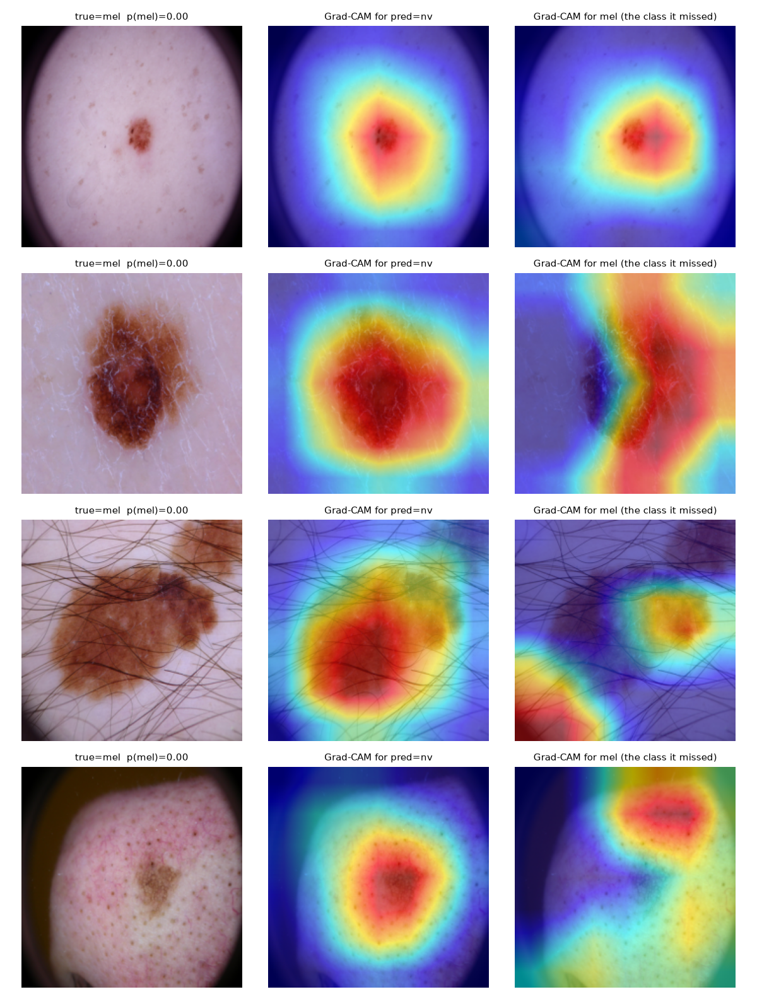
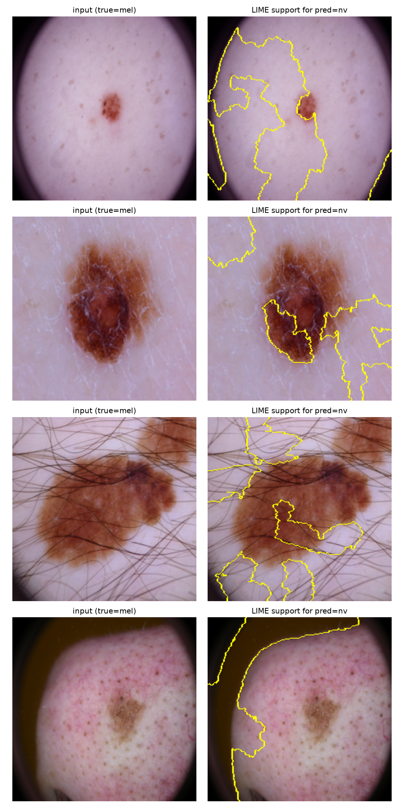

Let's analyze the images per case:

- **Case 1** (clean, well-centered lesion): Grad-CAM for `pred=nv` and for
  the missed `mel` target both concentrate tightly on the lesion, with
  near-identical footprints, so by Grad-CAM the model is looking at the right
  place and still gets it wrong. LIME is less clear: its `nv` outlines cover
  mostly the surrounding skin and small parts of the dark border, with only
  part of the lesion enclosed. This is most likely a modelling limit rather
  than something preprocessing would fix, but the two methods do not fully agree.
- **Case 2** — Grad-CAM for `nv` is centred on the lesion, but the `mel`-target
  map lies mostly on skin to the right of it. LIME's `nv` outlines cover one
  part of the lesion plus several patches of surrounding skin. No specific
  artefact (dense hair, dark corner) is visible, so this case is ambiguous:
  the model may be using skin context, and we cannot tell that apart from a
  genuinely hard lesion here.
- **Case 3** (dense hair): Grad-CAM's heat for the `mel` target splits off
  the lesion into the corner of the image, and LIME's support
  region for `nv` includes a chunk of hair-covered skin outside the lesion
  boundary. The hair is plausibly contributing to the wrong call.
- **Case 4** (dark dermatoscope vignette): Grad-CAM for `nv` is centred on the
  lesion, but for the missed `mel` target the heat moves off the lesion to the
  top of the image, close to the dark border. LIME's support region for `nv`
  lies entirely in the dark corner, none of it on the lesion.
  Same pattern: a non-lesion artefact plausibly contributing to the miss.


Two of the four most-confident melanoma misses (cases 3 and 4) show attention
plausibly drawn to hair or vignette artefacts rather than the lesion; case 1
looks like a genuinely hard lesion, and case 2 is ambiguous. That split matters practically: at least
part of the 24.8% malignant-missed-as-benign rate is not simply "the task is
hard", some of it may be addressable with hair/artefact-removal
preprocessing rather than requiring a larger or better model.

## Conclusion and limitations

Taken together, the experiments show mainly that a choice made for a screening task should be judged on the error that matters for that task, not on one aggregate score. In our runs the clinical criterion and macro-F1 happened to select the same model on validation, so this is an argument for how to evaluate, not something our results demonstrate.

The choice of backbone, a pretrained ResNet18 rather than a small CNN trained from scratch, mattered much more than the imbalance strategy, although I did not separate the effect of pretraining from that of architecture.

Imbalance handling mostly changes which classes are caught rather than the overall macro-F1, so it is a trade to be weighed against the intended use, not a free improvement. Even the model chosen on clinical "principles" misses a substantial share of malignant lesions, so these results say which choices help relative to one another, not that any of the models is fit for clinical use.

The interpretability analysis adds to the discussion the fact that the errors are not of one kind. Among the model's most confident melanoma misses, some seem to involve artefacts such as hair or the dermatoscope border, while others look like genuinely hard lesions. This suggests, as a hypothesis I did not test, that part of the remaining error is a data-quality problem that preprocessing could address.

Some limitations apply and must be considered still as open discussion points: (i) All comparisons come from one split and one seed, so small differences between runs should not be trusted. (ii) Validation and test scores agree, which suggests the figures are not inflated within this dataset, but nothing was tested on images from another source. (iii) Grad-CAM and LIME are approximate and were applied to a handful of cases, so they show where the model is sensitive, not why, or whether it is clinically meaningful. (iv) The malignant/benign grouping of lesion is my own simplification, done just to reason upon the task itself and provide a potentially interesting point of view, but was not validated by clinicians. (v) All predictions use the most probable class, with no tuned decision threshold. On the test set, `resnet_none` and `resnet_weighted` have almost the same macro-AUC, so part of the gap in missed malignant lesions may come from where the decision boundary falls rather than from a better model; lowering the threshold for malignant classes, tuned on validation, was not tested.


